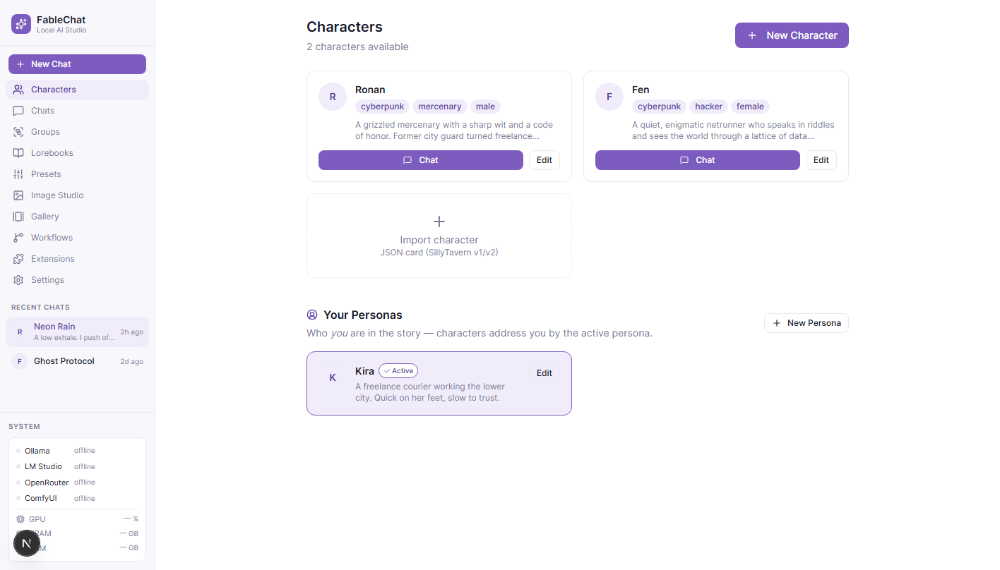

# CharacterBinderChat

**A local-first AI roleplay studio.** CharacterBinderChat (FableChat) is a Next.js app for deep, persistent, character-driven conversations with local or cloud LLMs — with a two-layer memory system that keeps the AI aware of everything that has happened in your story.


---

## What it is

Most AI chat apps forget everything the moment the context window fills up. CharacterBinderChat doesn't. It layers two complementary memory systems on top of any LLM:

- **Drawer 1 — Core Memory Block** (always in context): the character's current mood, emotional state, relationship with you, active commitments, internal thoughts, and a running narrative summary. Rewritten by the LLM after every exchange.
- **Drawer 2 — Bi-temporal Knowledge Graph** (retrieved): a SQLite graph of facts, entities, and relationship stats extracted from every conversation. Facts carry story-time and wall-time timestamps, so old beliefs are superseded rather than overwritten — you can ask "what did they believe *before* that happened?"

The result: characters that remember, grow, and stay consistent over hundreds of messages.

---

## Features

| Area | What's wired |
|------|-------------|
| **Chat** | Real streaming from Ollama, LM Studio, or OpenRouter. Stop mid-generation, regenerate, retry after a failure. |
| **Characters** | Full CRUD — create, edit, delete. Import SillyTavern v1/v2 JSON cards or **CharacterBinder PNG cards** — drop a PNG anywhere in the window and it routes by embedded type (character, lorebook, persona, scenario). The card art becomes the avatar. |
| **Card export & Quick Import** | Paste any character text (headed sections, W++, JSON, plain paragraphs) and review how it is sorted before applying. Download any character as a Tavern-format **PNG card** (your art embedded) or JSON, for SillyTavern, JanitorAI, Chub, Agnai, Venus, Backyard, RisuAI or generic JSON — and it tells you which of your fields the chosen site will drop. JanitorAI/Agnai/Backyard JSON imports too. Coming from CharacterBinder? Drop its "Archive All" .zip on the Characters screen and your whole collection comes across (safe to run twice). A character's lorebook is embedded in their card; lorebooks, personas and scenarios export too. Full card fields — example dialogue, system prompt, post-history instructions, alternate greetings, creator notes — are kept on import and written back on export. |
| **Personas** | Your identity in the roleplay. The active persona is injected into the prompt, labels your turns during extraction, and names the `player` entity in the graph. |
| **Groups + witness memory** | Multi-character scenes. Pick who replies (or auto by name-mention/round-robin), toggle who is present from the header — and each character only remembers what happened while they were in the scene. Talk about someone while they're away, and they genuinely don't know. Per-member memory inspector. |
| **Core Memory (Drawer 1)** | Per-character JSON document: mood (valence/arousal/dominance), 5-axis relationship stats, commitments, emotional events, internal thoughts, narrative summary. |
| **Knowledge Graph (Drawer 2)** | Bi-temporal SQLite graph. Entities, facts with supersession + semantic dedupe, relationship stat axes (affection / trust / desire / connection), commitments, episodic scene cards, reflections, shared-language "bits" (running jokes, nicknames), and a story clock. Auto-extracted after each message. Semantic retrieval via local Ollama embeddings, with a lexical fallback when Ollama is offline. |
| **Emotional dynamics** | Stats move non-linearly: headroom scaling near extremes, loss aversion on trust/affection drops, mood blending, and post-rupture inertia — a betrayal opens a refractory window where warmth recovers slowly and the wound stays in the prompt. |
| **Lorebooks** | Full editor: books, entries with comma-separated keywords, priorities, always-on (pinned) entries. Keyword-triggered injection as `[World Lore]` on every generation, with a token budget. |
| **Inspector Panel** | Right-side panel: Character · Core Mem · Memory · Web (mind-map graph) · Summary · Lore · Image Studio. The Memory tab has Facts (with history), Relationships, and Entities (with duplicate detection + merge). Every reply has a 🧠 provenance view showing exactly which memory shaped it. |
| **Model Selector** | Live model list from every connected provider, grouped by provider. Any model ID can be entered by hand — see [Choosing a model](#choosing-a-model). |
| **Persistence** | Chats, characters, and personas live in SQLite and survive clearing browser storage. One-click JSON export. |
| **Chat management** | Rename, delete, clear. Relative timestamps and last-message previews in the sidebar. |
| **Peek Prompt** | The eye icon in the chat header shows exactly what the model receives: the last prompt actually sent, or a live preview built by the same code. Answers "was that fact in the prompt?" directly. |
| **Branching** | "Branch from here" on any message copies the chat up to it, plus the memory the story had at that point (not today's). Each reply records a memory snapshot, so branches from new messages are exact; older ones are flagged approximate. |
| **Memory curation** | Edit a fact's wording, **pin** it (always in the prompt) or **lock** it (extraction can't replace it) from Memory → Facts. Editing locks automatically. |
| **Local access control** | Binds `127.0.0.1`. Other devices are refused unless you set `FABLE_PASSWORD`. Cross-site writes are refused. The OpenRouter key is stored encrypted on the server, not in the browser. |
| **Appearance** | Settings → Appearance: light / dark / match-system, nine accent presets or any custom color. Saved per browser. |
| **System Status** | Sidebar shows real-time connection status + loaded model per provider. |
| **Image Generation** | `/image <prompt>` renders real images through your local ComfyUI — no launch flags needed, FableChat proxies the connection server-side. Workflow templates live in `workflows/*.json` (API format with a `_meta.fablechat` node mapping). Per-chat generation settings (temperature / top-p / max tokens) live behind the gear icon in the chat header. |

<details>
<summary><strong>More screenshots</strong></summary>

**Knowledge graph — extracted facts with supersession history**


**Core Memory — the always-in-context character state**


**Characters and personas**



**Provider settings**


</details>

---

## Tech stack

- **Frontend**: Next.js 16 (App Router, Turbopack), React 19, Tailwind CSS 4, Zustand
- **Database**: `better-sqlite3` — synchronous SQLite, zero config, runs in the Next.js server process
- **Providers**: Ollama · LM Studio · OpenRouter (OpenAI-compatible) · ComfyUI
- **Memory**: Custom bi-temporal schema + Core Memory JSON document

---

## Getting started

### Prerequisites

- **[Node.js](https://nodejs.org) 22.18 or newer** (the "LTS" download is fine). That is the only thing to install.
- At least one LLM provider:
  - [Ollama](https://ollama.ai) (default: `http://127.0.0.1:11434`)
  - [LM Studio](https://lmstudio.ai) (default: `http://127.0.0.1:1234`)
  - Or an [OpenRouter](https://openrouter.ai) API key

### Run it

Download or clone the repository, then:

- **Windows:** double-click **`start.bat`**
- **macOS / Linux:** run **`./start.sh`**

The launcher checks Node, installs dependencies the first time, builds the app, starts it, and opens your browser at
[http://localhost:3000](http://localhost:3000). Run it again later and it opens the copy that is already running instead of
starting a second. After an update it rebuilds by itself. Keep its window open while you use FableChat; Ctrl+C stops it.
If port 3000 is busy it uses the next free one and says so.

The first run downloads about 300 MB of dependencies and takes a minute or two. If it fails mentioning `node-gyp`, the
message says which build tools to install.

The SQLite database is created automatically in `data/` on first run, and column upgrades apply when an older database is opened.
**Back it up** from Settings → Backup & restore.

Prefer a terminal, or developing on it?

```bash
git clone https://github.com/Fablestarexpanse/CharacterBinderChat.git
cd CharacterBinderChat
npm install
npm run dev          # development server with hot reload
```

### Configuration

All provider settings are in the **Settings** panel inside the app — no `.env` required for local providers. For OpenRouter, paste your API key in Settings → OpenRouter.

Optional env vars:

```env
FABLE_DB_PATH=/path/to/your/fablestore.db   # custom DB location
FABLE_PASSWORD=choose-one                   # required to use FableChat from another device
FABLE_SECRET_KEY=<64 hex characters>        # keep the API-key encryption key off disk
```

### Letting an AI agent build your characters

FableChat ships an [MCP](https://modelcontextprotocol.io) server so Claude Code, Claude Desktop or any MCP client can create and edit characters, lorebooks, personas and scenarios directly: *"a stoic dwarven blacksmith with a lorebook for his forge"*.

```bash
claude mcp add fablechat -- node /absolute/path/to/CharacterBinderChat/mcp/server.mjs
```

FableChat must be running. Set `FABLE_URL` if it is not on `http://127.0.0.1:3000`, and `FABLE_PASSWORD` if you started it with one. There is nothing to pair: changes are written to FableChat's server and appear in any open tab within a few seconds, announced in a banner that says who changed what and offers **Undo**. Every change an agent makes is reversible, including deletes, and a character's lorebook is removed with it if you undo its creation. If you edit the same character in the app at the same moment, the agent's version is kept and you are told.

### Using it from another device

`npm run dev` / `npm start` listen on `127.0.0.1` only, and anything addressed to another hostname is refused. To reach it from your phone or another computer, set `FABLE_PASSWORD` (any username, that password — the browser will prompt) and bind the network interface yourself:

```bash
FABLE_PASSWORD=choose-one npx next start -H 0.0.0.0
```

This is HTTP Basic auth over plain HTTP, which is fine on a home network and not on an untrusted one. Put it behind HTTPS (a reverse proxy or Tailscale) before exposing it further. API keys you enter are encrypted on the server with a key in `data/.fable-secret` (keep it out of backups, or set `FABLE_SECRET_KEY` instead); a copied database alone does not reveal them.

---

## Choosing a model

The dropdown in the chat header lists every model each connected provider reports — for OpenRouter that's the full catalogue (hundreds of models), sorted by ID. Native `<select>` type-ahead works: focus it and start typing `deepseek` to jump straight there.

To use a model that isn't listed — a brand-new release, a private deployment, or a self-hosted tag — pick **＋ Custom model ID…** at the bottom of the dropdown and enter the ID exactly as the provider names it:

| Provider | ID format | Example |
|---|---|---|
| OpenRouter | `vendor/model` | `deepseek/deepseek-v3.2-exp` |
| Ollama | `name:tag` | `llama3.2:latest` |
| LM Studio | whatever `/v1/models` reports | `local-model` |

Custom IDs are saved and appear in the dropdown from then on. Copy OpenRouter slugs from [openrouter.ai/models](https://openrouter.ai/models).

---

## Personas

A **persona** is who *you* are in the story — the mirror image of a character. Create one under **Characters → Your Personas**, then click its card to make it active.

The active persona does three things:

1. Adds a `[User Persona]` block to the system prompt, so the character addresses you by name instead of "user"
2. Labels your turns during memory extraction, so extracted facts are about *you*, not "the user"
3. Renames the `player` entity in the knowledge graph to match

Personas are global, not per-chat.

---

## Project layout

```
CharacterBinderChat/
├── start.sh, start.bat           # one-click launcher (both call scripts/start.mjs)
├── app/
│   ├── api/
│   │   ├── chat/core-memory/     # Drawer 1 CRUD + LLM refresh
│   │   ├── drawer/               # Drawer 2: entities, facts, stats, extract, branch, snapshot
│   │   ├── state/                # Durable app state: GET/PUT/PATCH + /changes (revisions)
│   │   ├── cards/                # Card API for outside writers (agents): create/edit/delete/undo
│   │   ├── backup/               # Full database backup and two-step restore
│   │   └── secrets/              # Encrypted API keys
│   └── page.tsx
├── components/
│   ├── cards/                    # Export buttons shared by every card kind
│   ├── characters/               # CharacterEditorDialog (+ Quick Import), PersonaEditorDialog
│   ├── chat/                     # ChatHeader, ChatInput, MessageItem, Peek Prompt
│   ├── inspector/                # CharacterTab, CoreMemoryTab, MemoryTab…
│   │   ├── graph/                # MemoryGraph — the story-web canvas
│   │   └── memory/               # Facts, Relationships, Entities sub-views
│   ├── sections/                 # One screen per sidebar entry
│   ├── sidebar/                  # Sidebar, SystemStatus
│   ├── ui/                       # Hand-rolled primitives (dialog is the one Radix wrapper)
│   ├── StateSync.tsx             # Mounts the sync engine
│   ├── SecretsSync.tsx           # Keeps API keys out of localStorage
│   └── RemoteChanges.tsx         # "An agent changed X — Undo" notices
├── lib/
│   ├── api/                      # server.ts (routeError, guard, envelope validator) + client.ts
│   ├── cards/                    # Card format: PNG codec, Tavern V2, platforms, converters, validator, Quick Import parser, zip reader
│   ├── chat/                     # generation, promptBuilder, lorebook, references, branch — client-safe
│   ├── db/                       # FableStore (better-sqlite3), schema, appState (revisions), backup, branch
│   ├── hooks/                    # useHydrated, useModelCatalog, useInspectedCharacter
│   ├── import/                   # Card files and CharacterBinder archives → the store
│   ├── llm/                      # Shared LLM transport, JSON parsing, embeddings
│   ├── providers/                # Ollama, LMStudio, OpenRouter, ComfyUI adapters
│   ├── security/                 # Local access rules (used by proxy.ts and guard)
│   ├── server/                   # memoryExtractor, retrieval, coreMemory, cards service, secrets — SQLite-side
│   ├── store/                    # Zustand client store (slices) + ui.ts, theme.ts, memorySettings.ts
│   ├── sync/                     # Sync engine, diff, remote-merge policy, lifecycle
│   ├── text/                     # Lexical overlap — the no-embeddings fallback
│   ├── types.ts                  # Shared wire and domain types
│   └── utils.ts                  # cn, downloads, time formatting, forbidden words
├── mcp/                          # MCP server for agents (a thin client of /api/cards)
├── proxy.ts                      # Access control for every request
├── scripts/                      # The launcher
└── data/
    └── fablestore.db             # auto-created SQLite database (back it up from Settings)
```

---

## How the memory system works

```
User sends message
       │
       ▼
 fetchCoreMemory()          ← GET /api/chat/core-memory
       │
       ▼
 buildSystemPrompt()        ← character + persona + mood + relationship + facts
       │
       ▼
 fitHistoryToBudget()       ← trims oldest turns to the model's context window
       │
       ▼
 provider.streamChat()      ← Ollama / LM Studio / OpenRouter (abortable)
       │
       ▼
 Response streams in        ← updateMessageContent() per token
       │
       ▼
 [parallel after complete]
  ├── /api/drawer/extract            ← Drawer 2: entities/facts/stats → SQLite,
  │                                    then syncs stats into Core Memory
  └── /api/chat/core-memory/refresh  ← Drawer 1: rewrites mood/persona/narrative
```

Extraction failures are surfaced, not swallowed: if the model returns unparseable JSON the route responds `502` and the Memory tab shows what went wrong.

### Data & backups

Chats, characters, personas, lorebooks and scenarios are written to SQLite a moment after every change, and the app
hydrates from the database on load, so clearing browser storage doesn't lose anything. Open tabs pick up changes made
elsewhere (an agent, another tab) within a few seconds.

**Back up from Settings → Backup & restore.** That file holds everything, including what the characters remember.
Restoring shows what a file contains before replacing anything, keeps the database it replaces as a safety copy, and
leaves your API keys alone (backups never contain them). The JSON export under *Your Data* is a portable copy of the
cards and chats, **without** the memory: it is not a backup.

---

## Status

Working end to end: chat + streaming, both memory drawers (with embeddings, episodic memory, shared language, story clock, and reply provenance), characters, personas, PNG/JSON card import, lorebooks with keyword injection, real ComfyUI image generation, per-chat generation settings, persistence, chat management, the model selector, the memory inspector, and the story-web mind map.

Every sidebar section is a working screen: Characters, Chats, Groups, Lorebooks, Scenarios, Presets, Image Studio, Gallery, Workflows and Settings.

Not yet built:

- **Some image-studio controls are decorative**: the LoRA stack, ControlNet, refiner, aspect-ratio and character-reference controls don't reach the workflow yet — prompt, dimensions, steps, CFG, sampler, seed and batch do.
- **Narrow screens**: below about 768 px the layout does not adapt yet (the sidebar and inspector do not collapse).
- **Images are stored inside the database rows** (as data URLs), which makes edits of characters with large avatars
  heavy and exports carry the 512 px copy rather than the original. An asset store is planned.

See `docs/audit-2026-11.md` for the full list and `docs/plan-2026-11.md` for the order of work.

---

## Roadmap

- [x] Character creation UI
- [x] User personas
- [x] Durable chat storage + export
- [x] Chat rename / delete / clear / regenerate
- [x] Custom model IDs
- [x] Real ComfyUI image generation
- [x] Lorebook editor + keyword injection
- [x] Per-chat generation settings
- [x] PNG card import (CharacterBinder / SillyTavern)
- [x] Group chats with witness-scoped memory
- [x] Card export (PNG/JSON, per platform), Quick Import, CharacterBinder archive import
- [x] Branch from any message, with memory as of that point
- [x] Fact editing, pinning and locks; Peek Prompt
- [x] Agents via MCP, with server-authoritative sync and undo
- [x] Full backup and restore; one-click launcher; local access control and encrypted keys
- [ ] Asset store for images (originals kept, smaller database)
- [ ] Library page: search, tags, bulk actions, archive export
- [ ] Mobile layout
- [ ] GPU / VRAM monitoring
- [ ] Export chat as story document

---

## Development

```bash
npm run dev        # Turbopack dev server
npm run build      # production build
npm run lint       # ESLint
npm run typecheck  # tsc --noEmit
npm test           # ~430 unit tests (node --test, no server, no API key)
npm run audit:prod # high/critical advisories in what ships
npm run eval:gate  # offline check of the extraction gate against recorded soaks
```

All of those but `eval:gate` run on every push, and so does the API suite — CI starts the dev
server on a scratch database and points `FABLE_TEST_URL` at it
(`.github/workflows/ci.yml`). To run that suite locally against your own server:

```bash
FABLE_TEST_URL=http://localhost:3001 npm run test:api   # route contracts, bi-temporal invariants, backup, and the MCP server end to end
```

Node 22.18 or newer is required for the tests (they load the app's `.ts` modules through Node's type stripping).
There are no browser tests in CI yet; changes to sync or the UI have been verified by hand in a browser.

It writes only under per-run ids and cleans up after itself, but it does write,
so point it at a scratch `FABLE_DB_PATH` if that matters to you.

One suite stays manual — it calls a paid model and takes minutes:

```bash
npm run eval                                            # scripted scenarios through a real model
```

`npm test` loads the app's own `.ts` modules through Node's type stripping — no build step and no test-only bundle, so nothing can pass there while the app fails. A small resolve hook (`tests/unit/loader.mjs`) teaches Node the `@/` alias and extensionless imports, so the suite reaches FableStore and retrieval as well as the pure modules.

The Python reference implementation of Drawer 2 — including a 77-test pytest suite that documents the intended bi-temporal semantics — lives in `../fable_drawer2/`. `tests/unit/schema.test.mjs` and `tests/api/bitemporal.test.mjs` assert the parts of that spec the TypeScript port must honour.

---

## License

MIT. Code ported from CharacterBinder is MIT too; its notice is in [`THIRD_PARTY_NOTICES.md`](THIRD_PARTY_NOTICES.md).
