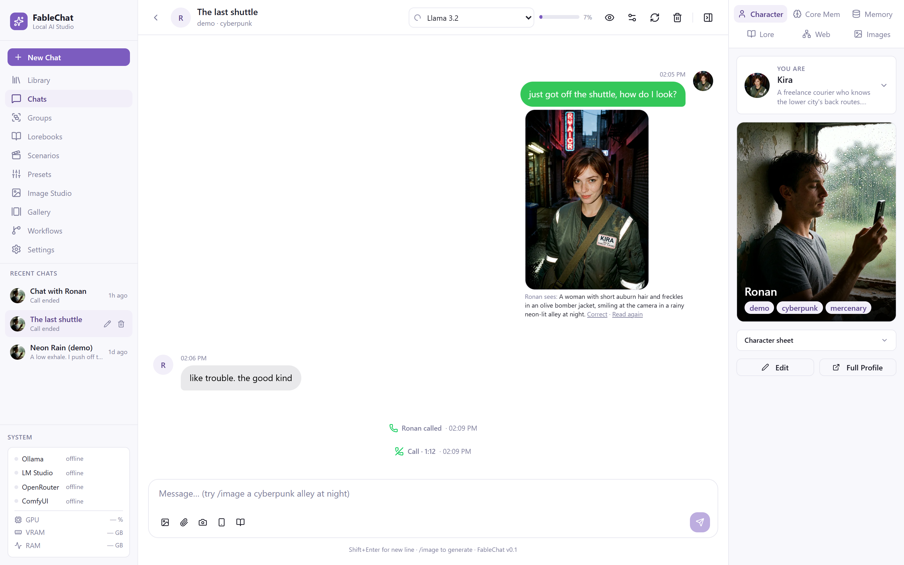
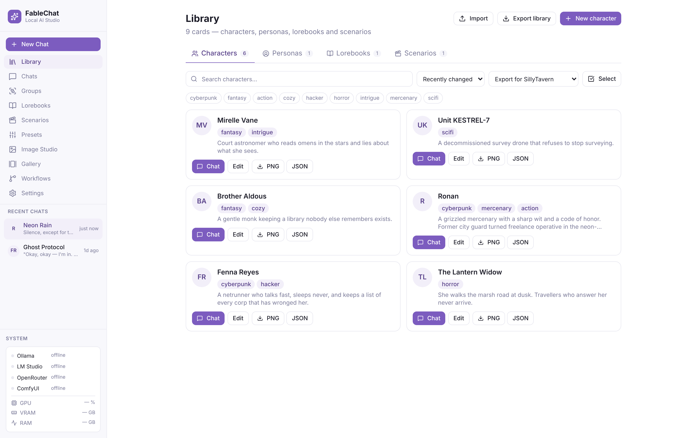
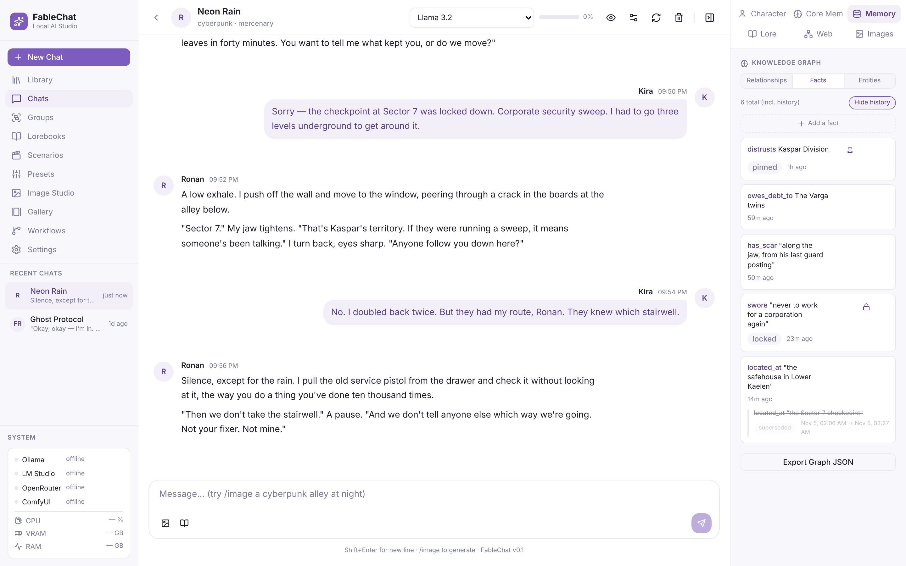
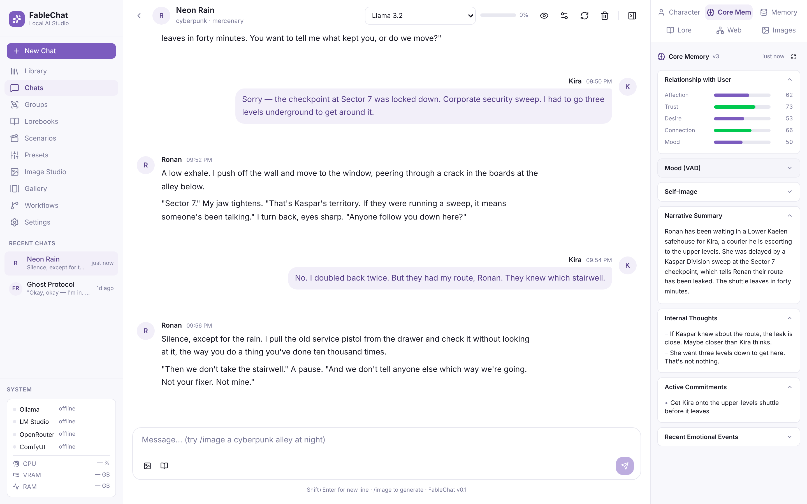
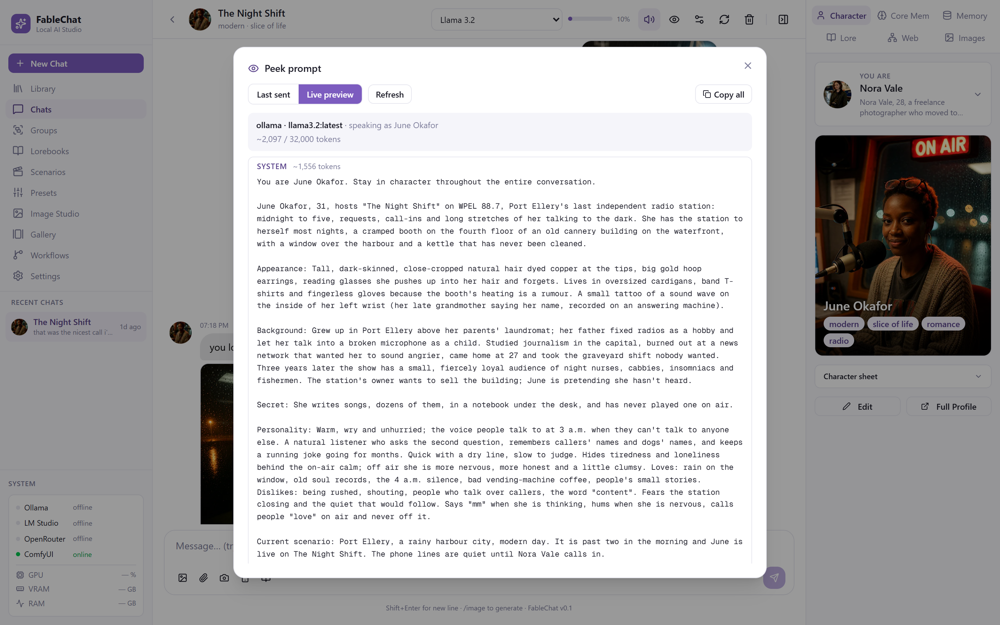
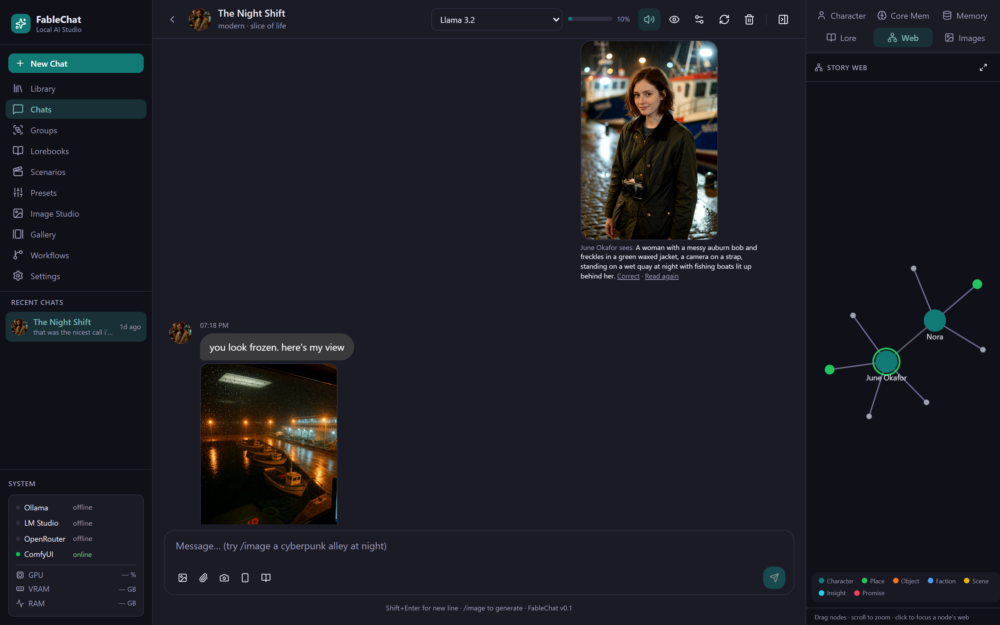
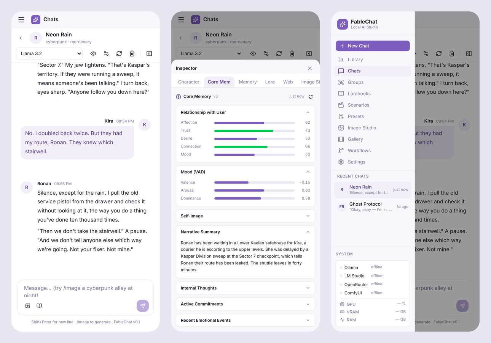
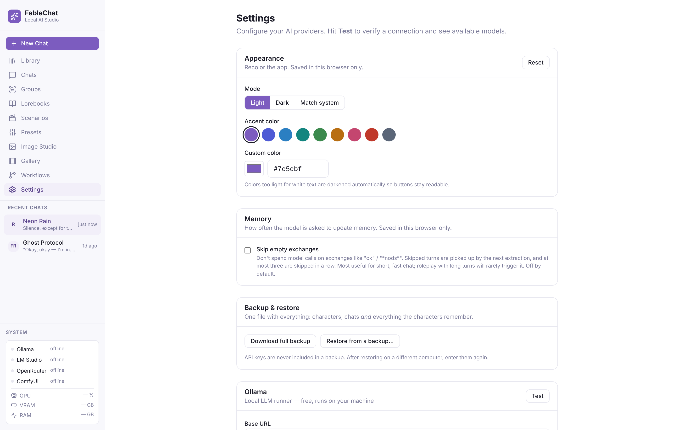

# FableChat

**A local-first AI roleplay studio.** FableChat is a Next.js app for long, persistent, character-driven stories with
local or cloud LLMs. A two-layer memory system keeps the model aware of everything that has happened, and a built-in
card library (what used to be the separate CharacterBinder tool) holds your characters, personas, lorebooks and
scenarios.



---

## What makes it different

Most AI chat apps forget everything once the context window fills up. FableChat layers two memory systems over any
model, both scoped to a single chat:

- **Drawer 1 — Core Memory** (always in the prompt): the character's mood, their relationship with you, active
  commitments, internal thoughts and a running summary. Rewritten after every exchange.
- **Drawer 2 — a bi-temporal knowledge graph** (retrieved): facts, entities and relationship stats extracted from the
  conversation into SQLite. Facts carry story time and wall time, so a changed belief supersedes the old one instead
  of overwriting it, and you can ask what a character believed *before* something happened.

The result is characters that remember, change and stay consistent over hundreds of messages.

---

## Getting started

You need **[Node.js](https://nodejs.org) 22.18 or newer** (the LTS download is fine) and at least one model provider:
[Ollama](https://ollama.ai), [LM Studio](https://lmstudio.ai), or an [OpenRouter](https://openrouter.ai) API key.

Download or clone the repository, then:

- **Windows:** double-click **`start.bat`**
- **macOS / Linux:** run **`./start.sh`**

The launcher checks Node, installs dependencies the first time, builds the app, starts it and opens
[http://localhost:3000](http://localhost:3000). Run it again and it opens the copy already running instead of starting
a second one; after an update it rebuilds by itself. Keep its window open while you use FableChat; Ctrl+C stops it. If
port 3000 is busy it uses the next free one and says so.

The first time it opens, you land in a **demo story**: Ronan, a mercenary in a rain-soaked cyberpunk city, waiting
for you (as Kira, a courier) with a small lorebook and a chat a few lines in. Pick a model in the chat header and reply
to see memory form in the inspector. Edit or delete any of it; once deleted it stays deleted, and **Library → Add the
demo story** brings it back.

The first run downloads about 300 MB and takes a minute or two. If it fails mentioning `node-gyp`, the message says
which build tools to install.

Provider settings live in **Settings** inside the app; nothing needs a `.env`. For OpenRouter, paste your key in
Settings → OpenRouter (it is stored encrypted on the server, not in the browser). Your data is a SQLite database in
`data/`, created on first run. **Back it up** from Settings → Backup & restore.

Developing on it instead:

```bash
git clone https://github.com/Fablestarexpanse/CharacterBinderChat.git
cd CharacterBinderChat
npm install
npm run dev
```

---

## Features

| Area | What it does |
|------|-------------|
| **Chat** | Streaming from Ollama, LM Studio or OpenRouter. Stop mid-reply, regenerate, retry after a failure; rename, clear, delete. |
| **Library** | One screen for every card: characters, personas, lorebooks and scenarios in tabs, with search, sort, tag filter and multi-select. Export a selection or the whole library as one .zip that imports back; bulk delete warns which chats are affected. Editors ask before discarding unsaved changes. |
| **Card import & export** | Drop PNG or JSON cards (SillyTavern v1/v2, CharacterBinder, JanitorAI, Agnai, Backyard) or a CharacterBinder "Archive All" .zip anywhere in the window. Export any character as a Tavern PNG card (art embedded) or JSON for SillyTavern, JanitorAI, Chub, Agnai, Venus, Backyard, RisuAI or generic JSON, and see which fields that site will drop. Example dialogue, system prompt, post-history instructions, alternate greetings and creator notes round-trip; a character's lorebook travels inside its card. |
| **Quick Import** | Paste any character text (headed sections, W++, JSON, plain paragraphs) and review how it is sorted into fields before applying. |
| **Personas** | Who *you* are in the story. The active persona is in the prompt, labels your turns during extraction and names the `player` entity in the graph. |
| **Groups + witness memory** | Multi-character scenes. Pick who replies or let it choose; toggle who is present, and each character only remembers what happened while they were there. |
| **Core Memory** | Mood (valence / arousal / dominance), relationship stats, commitments, emotional events, internal thoughts and a narrative summary. |
| **Knowledge graph** | Entities, facts with supersession and semantic de-duplication, relationship stats (affection / trust / desire / connection), commitments, episodic scene cards, reflections, running jokes and nicknames, and a story clock. Retrieval uses local Ollama embeddings when available and falls back to lexical ranking. |
| **Emotional dynamics** | Stats move non-linearly: headroom near the extremes, loss aversion on drops in trust and affection, blended mood, and post-rupture inertia, so a betrayal heals slowly and stays in the prompt. |
| **Lorebooks & scenarios** | Keyword-triggered world lore with priorities, always-on entries and a token budget. Scenarios are reusable scene setups with their own opening message. |
| **Inspector** | A side panel with Character · Core Mem · Memory (Relationships, Facts with history, Entities with duplicate merge) · Lore · Web (the story as a mind map) · Images. All six tabs are visible at once. Every reply has a 🧠 view of the memory that shaped it. |
| **Memory curation** | Edit a fact, **pin** it (always in the prompt) or **lock** it (extraction can't replace it). Editing locks automatically. |
| **Peek Prompt** | The eye icon shows exactly what the model receives: the last prompt sent, or a live preview built by the same code. |
| **Branching** | "Branch from here" on any message copies the chat up to that point together with the memory it had *then*. Branches from newer messages are exact; older ones are flagged approximate. |
| **Agents (MCP)** | Claude Code, Claude Desktop or any MCP client can create and edit cards, portraits included. Changes appear in open tabs within seconds, with **Undo**. |
| **Backup & restore** | One file holds everything, memory included. Restore shows what a file contains first and keeps the database it replaces. |
| **Image generation** | `/image <prompt>` renders through your local ComfyUI, proxied by the server. Workflow templates live in `workflows/*.json`. |
| **Model selector** | Every model each provider reports, plus any ID typed by hand (see [Choosing a model](#choosing-a-model)). Per-chat temperature, top-p and max tokens behind the gear icon. |
| **Appearance** | Light, dark or match system; nine accent colours or any custom one. |
| **Phones and narrow windows** | Below 768 px the sidebar becomes a drawer and the inspector a sheet over the chat. |
| **Local access control** | Listens on `127.0.0.1` only. Other devices are refused unless you set `FABLE_PASSWORD`; cross-site writes are refused. |

<details>
<summary><strong>More screenshots</strong></summary>

**Library — every card in one place**



**Knowledge graph — facts with supersession history, one pinned and one locked**



**Core Memory — the always-in-context character state**



**Peek Prompt — exactly what the model receives**



**Dark mode with a custom accent, and the story web**



**On a phone — chat, inspector sheet, menu drawer**



**Settings — appearance, memory, backup and providers**



</details>

---

## Using it

### Personas

Create one in **Library → Personas**, then choose **Use as me**. Personas are global, not per chat.

### Choosing a model

The dropdown in the chat header lists what each connected provider reports; for OpenRouter that is the full catalogue.
Focus it and type (`deepseek`) to jump. For anything not listed, pick **＋ Custom model ID…** and enter it exactly as
the provider names it:

| Provider | ID format | Example |
|---|---|---|
| OpenRouter | `vendor/model` | `deepseek/deepseek-v3.2-exp` |
| Ollama | `name:tag` | `llama3.2:latest` |
| LM Studio | whatever `/v1/models` reports | `local-model` |

Custom IDs are remembered. OpenRouter slugs are listed at [openrouter.ai/models](https://openrouter.ai/models).

### Letting an AI agent build your characters

FableChat ships an [MCP](https://modelcontextprotocol.io) server, so an agent can take *"a stoic dwarven blacksmith with
a lorebook for his forge"* and write the cards itself:

```bash
claude mcp add fablechat -- node /absolute/path/to/CharacterBinderChat/mcp/server.mjs
```

FableChat must be running. Set `FABLE_URL` if it is not on `http://127.0.0.1:3000`, and `FABLE_PASSWORD` if you
started it with one. Every change an agent makes is announced in the open tab and can be undone, deletes included. If
you edit the same card at the same moment, the agent's version is kept and you are told.

### Using it from another device

By default anything addressed to a hostname other than localhost is refused. To use FableChat from your phone or
another computer, set a password and bind the network interface yourself:

```bash
FABLE_PASSWORD=choose-one npx next start -H 0.0.0.0
```

That is HTTP Basic auth over plain HTTP: fine on a home network, not on an untrusted one. Put it behind HTTPS (a
reverse proxy or Tailscale) before exposing it further.

### Your data

Chats and cards are saved to SQLite a moment after every change, so clearing browser storage loses nothing, and open
tabs pick up changes made elsewhere within a few seconds. **Settings → Backup & restore** is the real backup: it
includes what the characters remember and never includes your API keys. The JSON export under *Your Data* is a
portable copy of cards and chats **without** memory, so it is not a backup.

API keys are encrypted with a key in `data/.fable-secret`. Keep that file out of copies you share, or set
`FABLE_SECRET_KEY` instead.

Optional environment variables:

```env
FABLE_DB_PATH=/path/to/fablestore.db    # database location (default: data/fablestore.db)
FABLE_PASSWORD=choose-one               # required to use FableChat from another device
FABLE_SECRET_KEY=<64 hex characters>    # keep the API-key encryption key off disk
```

---

## How the memory system works

```
User sends message
       │
       ▼
 assemblePrompt()           ← character + persona + core memory + retrieved facts + lore,
       │                      history trimmed to the model's context window
       ▼
 provider.streamChat()      ← Ollama / LM Studio / OpenRouter, from the browser (abortable)
       │
       ▼
 [after the reply completes, in parallel]
  ├── /api/drawer/extract            ← Drawer 2: entities, facts, stats → SQLite,
  │                                    then stats synced into Core Memory
  └── /api/chat/core-memory/refresh  ← Drawer 1: mood, thoughts, narrative rewritten
```

Extraction failures are surfaced, not swallowed: unparseable model output returns `502`, and the Memory tab shows what
went wrong.

---

## Status and roadmap

Everything above works end to end. Known gap: some Image Studio controls (LoRA stack, ControlNet, refiner, aspect
ratio, character reference) don't reach the workflow yet; prompt, size, steps, CFG, sampler, seed and batch do.

The current plan is [`docs/plan-2026-11.md`](docs/plan-2026-11.md), drawn from the audit in
[`docs/audit-2026-11.md`](docs/audit-2026-11.md). Next up:

- [ ] Browser smoke tests in CI
- [ ] Sync engine ordering rules under unit test
- [ ] Persona, scenario and lorebook fields on a par with characters
- [ ] Agent activity view and memory tools over MCP
- [ ] Context-budget breakdown per prompt section
- [ ] GPU / VRAM monitoring
- [ ] Export a chat as a story document
- [ ] Characters who text you, with photos, video and voice that look like them (opt-in): [`docs/plan-contact-media.md`](docs/plan-contact-media.md)

---

## Development

**Stack:** Next.js 16 (App Router, Turbopack), React 19, Tailwind CSS 4, Zustand, and `better-sqlite3` running inside
the Next server process.

```bash
npm run dev        # dev server with hot reload
npm run build      # production build
npm run lint       # ESLint
npm run typecheck  # tsc --noEmit
npm test           # ~450 unit tests (node --test, no server, no API key)
npm run audit:prod # high/critical advisories in what ships
npm run eval:gate  # offline check of the extraction gate against recorded soaks
```

CI (`.github/workflows/ci.yml`) runs all of those except `eval:gate` on every push, plus the API suite against a dev
server on a scratch database. To run the API suite yourself:

```bash
FABLE_TEST_URL=http://localhost:3001 npm run test:api
```

It covers route contracts, bi-temporal invariants, backup and the MCP server end to end. It writes only under per-run
ids and cleans up after itself, but it does write, so point the server at a scratch `FABLE_DB_PATH` if that matters.

One suite stays manual because it calls a paid model and takes minutes:

```bash
npm run eval
```

`npm test` loads the app's own `.ts` files through Node's type stripping (hence Node 22.18+), with no build step or
test bundle, so nothing can pass there while the app fails. `tests/unit/loader.mjs` teaches Node the `@/` alias and
extensionless imports. There are no browser tests in CI yet; UI and sync changes are verified in a browser by hand.

The Python reference implementation of Drawer 2, whose 77-test suite documents the intended bi-temporal semantics,
lives in `../fable_drawer2/`. `tests/unit/schema.test.mjs` and `tests/api/bitemporal.test.mjs` hold the TypeScript
port to it. Conventions for working on the code are in [`AGENTS.md`](AGENTS.md).

### Project layout

```
CharacterBinderChat/
├── start.sh, start.bat     # one-click launcher (both call scripts/start.mjs)
├── app/api/
│   ├── chat/core-memory/   # Drawer 1: read, patch, LLM refresh
│   ├── drawer/             # Drawer 2: entities, facts, stats, extract, branch, transfer
│   ├── state/              # app state: GET / PUT / PATCH and /changes (revisions)
│   ├── cards/              # card API for outside writers (agents): create, edit, delete, undo, avatar
│   ├── assets/             # content-addressed images
│   ├── backup/             # full backup and two-step restore
│   ├── secrets/            # encrypted API keys
│   └── comfyui/, image/, ollama/, workflows/   # provider proxies and image workflows
├── components/
│   ├── sections/           # one screen per sidebar entry (LibraryView, ChatsView, …)
│   ├── chat/               # header, composer, messages, Peek Prompt
│   ├── inspector/          # the side panel: memory views, story web
│   ├── characters/         # character and persona editors, chat start
│   ├── sidebar/            # sidebar, narrow-screen drawer, system status
│   └── ui/                 # hand-rolled primitives (dialog is the one Radix wrapper)
├── lib/
│   ├── cards/              # PNG codec, Tavern V2, platforms, converters, validator, zip read/write, archives
│   ├── chat/               # generation, prompt assembly, lorebook, references, branch (client-safe)
│   ├── db/                 # FableStore (SQLite), schema, revisions, assets, backup, branch
│   ├── import/             # card files and archives → the store
│   ├── server/             # extraction, retrieval, core memory, card service, secrets (server-only)
│   ├── sync/               # sync engine, diff, merge policy, lifecycle
│   ├── providers/          # Ollama, LM Studio, OpenRouter, ComfyUI
│   ├── llm/                # shared transport, JSON parsing, embeddings
│   ├── store/              # Zustand stores
│   └── security/           # local access rules (used by proxy.ts)
├── mcp/                    # MCP server for agents (a thin client of /api/cards)
├── proxy.ts                # access control for every request
└── data/fablestore.db      # your database (created on first run)
```

---

## License

MIT. Code ported from CharacterBinder is MIT too; its notice is in [`THIRD_PARTY_NOTICES.md`](THIRD_PARTY_NOTICES.md).
